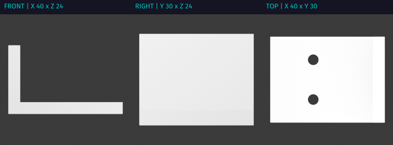
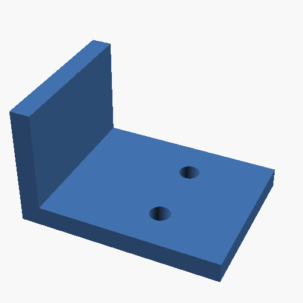
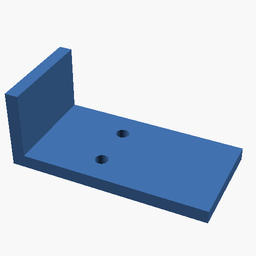
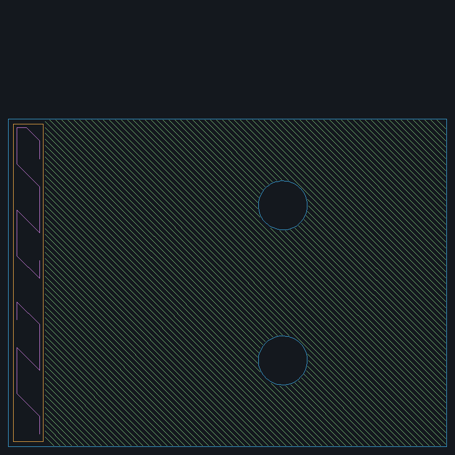
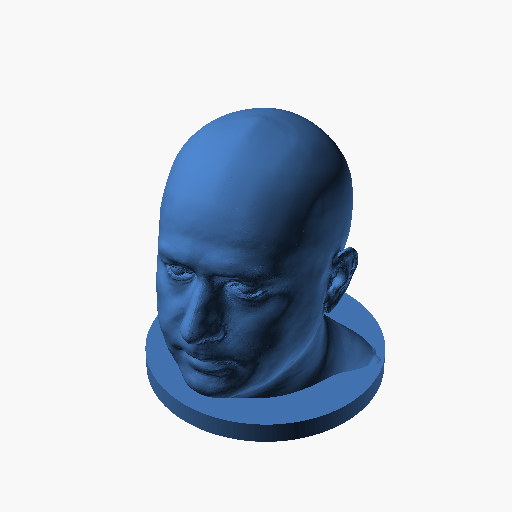

# Printable

Create and revise 3D models, render images and videos, and slice and send prints
through your AI assistant. Printable brings Blender, OpenSCAD, CadQuery, and
OrcaSlicer into one project workspace, with optional Bambuddy integration to
send files to a printer and start the job.



Actual output from the [bracket tutorial](docs/getting-started.md), in millimetres.
The tutorial produces STL, PNG, BLEND, and MP4 files you can download and inspect.

## Get started

Run Printable on a self-hosted **Linux/amd64 machine with an NVIDIA GPU**.
You supply a client that supports authenticated streamable HTTP MCP: the
connection that lets your assistant call the modeling and printing tools.
No particular model provider or gateway is required by the server.

Follow [installation](docs/installation.md) for the matching images, protected
credential, and Compose services. Then run from the repository root:

```sh
python3 scripts/quickstart.py .dev/first-bracket
```

The tutorial saves the previous live scene before replacing it with the bracket.
[First model and client setup](docs/getting-started.md) explains the outputs,
file retrieval, and what to do when a step fails.

## What do you want to make?

| Task | What Printable helps you do | Guide |
| --- | --- | --- |
| A bracket, enclosure, or other dimensioned part | Build editable OpenSCAD or CadQuery source, change parameters, and check geometry and requirements | [Functional parts](docs/workflows/functional-parts.md) |
| A variation of an existing design | Find files on MakerWorld, Printables, or Thingiverse; inspect STEP assemblies or meshes; retain attribution | [Reuse a design](docs/workflows/reuse-designs.md) |
| A relief, mold master, tray, or cavity | Calibrate image heights, build and inspect the geometry, and check the sliced detail | [Images to models](docs/workflows/images-to-models.md) |
| An object or portrait bust from images | Generate object shapes with Pixal3D or TRELLIS.2, or reconstruct and prepare FLAME heads for printing | [Photo workflows](docs/workflows/images-to-models.md) |
| A Blender scene, product image, or animation | Model with Python, inspect the native viewport/editor, compare views, and render saved checkpoints in the background | [Blender workflow](docs/workflows/blender.md) |
| A physical print | Select OrcaSlicer profiles, slice STL/3MF, review actual toolpaths, then send and start a job through Bambuddy | [Model to printer](docs/workflows/model-to-printer.md) |
| A design you can find and use again | Search your own projects, browse covers and files, and select explicit part-family variants | [Project library](docs/workflows/reuse-designs.md#find-your-own-work-again) |

## Change a part and check the result

The [CadQuery example](docs/workflows/functional-parts.md) widens a bracket while
keeping its mounting holes in place. Source, build requests, measurements, and
exported geometry stay together.

| 40 mm base | 60 mm base |
| --- | --- |
|  |  |

These OpenSCAD views show the actual CAD-exported meshes, framed independently.
The numerical reports show unchanged hole centers and 2 mm radii in both builds.
See the [recorded example](evidence/documentation-workflows.md) for reproduction
and the limits of those checks.

## Slice it and send it to a printer

Printable includes native OrcaSlicer preparation. Choose printer, process,
filament, and physical build-surface settings, prepare the model, and inspect
selected layers of the generated G-code. Download the printer-ready package or
send it through Bambuddy, review the target and materials, stage it for manual
start, and explicitly start the job when authorized and physically ready.



This is the tutorial bracket's actual toolpath preview. No physical print was
started for this example. The [complete guide](docs/workflows/model-to-printer.md)
covers preparation, submission, start, status, camera checks, and recovery.

## Capabilities and optional setup



The [portrait example](docs/workflows/images-to-models.md#portraits-to-a-bust)
shows its source photograph, fit diagnostic, and actual bust output, including
the limitations of the reconstruction and remaining print-preparation checks.

The standard installation includes Blender modeling and background rendering,
OpenSCAD, native CAD/STEP, and slicing. Modeling and slicing work without a
connected printer. [Engines and integrations](docs/index.md#engines-and-integrations)
explains what each capability adds and how to enable it.

- [Bambuddy](docs/printer-integration.md) connects printer delivery, start/control,
  materials, history, status, and camera observations.
- [Model sites](docs/model-library.md) provide search and downloads with
  site-specific authentication and license requirements.
- [Photo workers and head models](docs/workflows/images-to-models.md) need
  separate model files; available actions depend on readiness.
- [The read-only web library](docs/project-library.md#web-page) is optional.
  Project search and part families are also available through MCP.
- [Bundled skills](docs/workflow-interface.md#results-and-delivery) guide FDM
  preparation, image-to-mold work, and camera inspection. The client runs them;
  loading instructions does not execute a workflow or start monitoring.

## Optional print failure detection

Bambuddy can use the optional upstream Obico ML service for ongoing failure
detection and configured notifications/actions. See
[Obico setup](docs/print-failure-detection.md). Client vision assessments use the
separate [camera inspection skill](docs/printer-camera-inspection.md).

## Boundaries

This is a shared service for a trusted person or team. The bearer grants access
to the shared scene and workspace, including Python execution inside Blender.
It does not provide tenant isolation or a Python sandbox. Keep Blender's bridge
private and use HTTPS for remote MCP access.

Read the reported checks and their scope. Learned photo geometry can be wrong;
a closed mesh or attractive render does not establish physical fit, strength,
or successful printing. Toolpath review, printer readiness, and physical testing
answer different questions. Starting or resuming a print requires the applicable
authorization and current physical setup information.

## Documentation and project information

- [All guides and integrations](docs/index.md) and [tool/action reference](docs/workflow-interface.md).
- [Operations and backups](docs/operations.md), [render recovery](docs/render-worker.md),
  [architecture](docs/architecture.md), and [release images](docs/releases.md).
- [Contributing](CONTRIBUTING.md), [documentation writing](docs/writing.md),
  [CI](docs/continuous-integration.md), and [security reporting](SECURITY.md).
- [Issues and support](https://github.com/chrisbennight/mcp-printable-rs/issues)
  in the maintained public repository; no guaranteed response time.

First-party source uses the [MIT license](LICENSE). Bundled software, models,
and fonts retain their own licenses; see [component notices](THIRD_PARTY_NOTICES.md).
See [image sources](docs/images/README.md) for the examples used in these guides.
