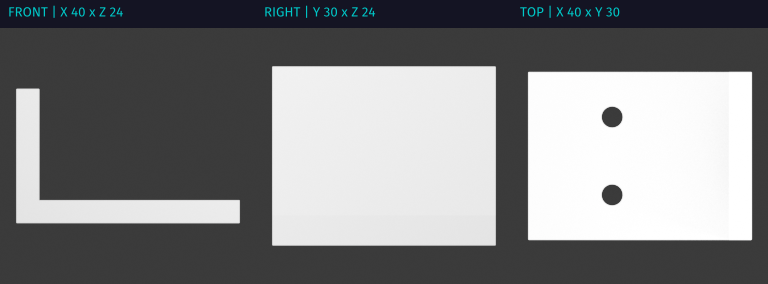

# Make your first model

The bracket tutorial creates a model, checks its mesh, renders dimensioned views,
saves a Blender checkpoint, and downloads STL, PNG, BLEND, and MP4 files. Use
it to check the installation before asking an assistant to build your own design.



This is the tutorial's actual output: a 40 × 30 × 24 mm bracket. Its
[recorded run](../evidence/quickstart-artifacts.md) used software graphics;
it is not a GPU performance measurement or a photograph of a printed part.

## Install the service

Follow [installation](installation.md) on a Linux/amd64 host with an NVIDIA GPU,
Docker Engine and Compose, and the NVIDIA Container Toolkit. Python 3.11 or
newer runs the included client. The guide covers matching images, a protected
credential, workspace storage, startup, and readiness.

The service provides Blender, OpenSCAD, native CAD, and slicing. You supply an
MCP client: an application that lets your assistant call Printable's tools.
The server does not require a particular model provider or gateway.

Run these commands from the repository root after installation:

```sh
python3 scripts/printable_client.py status
python3 scripts/quickstart.py .dev/first-bracket
```

Choose a new output directory for each run. The tutorial saves the previous
live scene before replacing it; it prints that checkpoint path and its render
job ID. It leaves the bracket as the live scene. Share a server only with people
whose work you are authorized to change.

In `.dev/first-bracket`, open `dimensions.png` and `turntable.mp4`; import
`bracket.stl` into a slicer or open `bracket.blend` in Blender. The JSON files
keep the inspection, validation, and job results. A closed solid and a good
render do not establish fastener fit or load capacity.

## Connect your assistant

Configure a client that supports authenticated **streamable HTTP MCP**.
The default local endpoint is `http://127.0.0.1:8000/mcp`; stdio is not supported.
Use HTTPS through a trusted proxy for remote access. Configure the bearer from
`.dev/mcp-bearer` through your client's protected credential settings; never
paste it into a prompt, command, or issue. Client-specific configuration fields
vary. Follow that client's HTTP MCP instructions rather than copying a stdio
configuration from another Blender project.

Ask the connected assistant to read `status`, discover its available tools,
and inspect the scene. A useful next request is:

> Make a mounting bracket with a 40 × 30 mm base, a 24 mm overall height,
> and two 4 mm holes. Keep the editable source. Show the dimensions and the
> mesh checks, and give me the STL. Do not send it to a printer yet.

This is an example request, not a recorded conversation or a guarantee that
every model produces the same design. The
[functional-part tutorial](workflows/functional-parts.md) provides fixed source
and requests for a reproducible build and parameter change.

## Retrieve files

Some MCP clients can use tools but do not implement Printable's
`files/authorizeDownload` extension. The included direct client can retrieve
the same artifacts without a gateway:

```sh
python3 scripts/printable_client.py tools
python3 scripts/printable_client.py contracts cad_build model
python3 scripts/printable_client.py call inspect examples/quickstart/inspect.json
```

Use the workspace path returned by a build or render in the download command:

```sh
python3 scripts/printable_client.py download projects/bracket-tutorial/bracket-40/model.stl .dev/bracket.stl
```

That path is produced by the functional-part tutorial, not by the first-bracket
script, which prints its own generated paths. Downloads verify size and SHA-256
and refuse to overwrite an existing local file. For another server, put the
client's `--url` and `--bearer-file` options before the subcommand.

## When a step fails

| What happened | Next action |
| --- | --- |
| HTTP responds but modeling is unavailable | Check dependency readiness and container state in [installation](installation.md); liveness alone is insufficient |
| An optional photo, model-site, or printer feature is missing | Check its [setup requirements](index.md#engines-and-integrations) and the available actions in `tools/list` |
| A CAD waiter disconnects | Inspect the original build with `status` or `wait-cad`; admitted work may still be running |
| A Blender edit or printer command times out | Inspect state or restore the saved checkpoint before deciding what to do; the mutation may already have happened |
| A file link expires | Request a fresh publication/download of the retained artifact; do not repeat the modeling operation |

Next, [revise a functional part](workflows/functional-parts.md),
[reuse a design](workflows/reuse-designs.md), or
[slice and send a print](workflows/model-to-printer.md).
