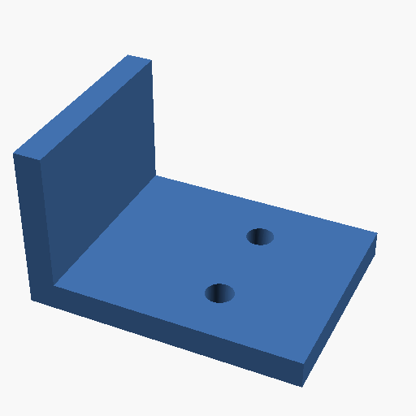
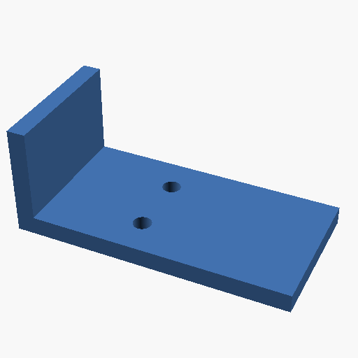

# Make and revise a functional part

Build a bracket from editable CadQuery source, make its base wider, and check
that the mounting holes stayed in place. You get STEP and STL geometry, a GLB
for presentation, and a numerical report alongside the retained build inputs.

| 40 mm base | 60 mm base |
| --- | --- |
|  |  |

These are OpenSCAD views of the actual CadQuery-exported STLs. Each view is
framed independently; use the measurements below to compare size. The bracket
is an example shape, not a tested load-bearing design.

## Build the first version

Complete [installation](../installation.md), then run from the repository root.
These examples use `bracket-tutorial`; choose another project ID and update the
request files if that name already belongs to unrelated work. Each build needs
a new output directory, so inspect existing results before rerunning a request.

```sh
python3 scripts/printable_client.py call project examples/workflows/project.json
```

Upload the [source](../../examples/workflows/bracket.py) using the existing
direct client. This code reads the credential file internally and never prints it:

```sh
PYTHONPATH=scripts python3 - <<'PY'
import base64
from pathlib import Path
from printable_client import Client

source = Path("examples/workflows/bracket.py").read_bytes()
with Client("http://127.0.0.1:8000/mcp", Path(".dev/mcp-bearer")) as client:
    client.call("artifact", {"action": "write", "params": {
        "path": "projects/bracket-tutorial/bracket.py",
        "data_base64": base64.b64encode(source).decode("ascii")
    }})
PY
python3 scripts/printable_client.py call cad_build examples/workflows/bracket-40.json
python3 scripts/printable_client.py wait-cad bracket-tutorial bracket-40
```

The worker receives `cq` and the request's `parameters`; the script assigns
its geometry to `result`. It builds the base and upright, then cuts holes at
fixed XY coordinates. No Blender scene is replaced.

Read `result.completion`, `result.qualification`, and `result.report` from the
completed status. Completion means the exports were written; qualification
checks the requested policy. Here `printable_part` requests valid positive-volume
geometry, the given dimensions, and one solid. Physical fit and strength still
need testing. See [CAD qualification](../cad-build.md#completion-and-delivery-qualification).

## Make a change and check what stayed fixed

```sh
python3 scripts/printable_client.py call cad_build examples/workflows/bracket-60.json
python3 scripts/printable_client.py wait-cad bracket-tutorial bracket-60
```

Compare `report.bounds_mm.size` and `report.vertical_holes.holes`:

| Measurement | First version | Wider version |
| --- | --- | --- |
| Overall X/Y/Z size | 40 × 30 × 24 mm | 60 × 30 × 24 mm |
| Hole centers, XY | (25, 8), (25, 22) mm | (25, 8), (25, 22) mm |
| Hole radius | 2 mm | 2 mm |
| Valid solids | One | One |

These values were observed in the [example run](../../evidence/documentation-workflows.md).
The parameter changes width; the hole positions are explicit source coordinates.
Keeping source and build directories makes the change inspectable. For durable
requirements and parent-linked source snapshots, use
[design revisions](../project-revisions.md). They can check a declared hole
pattern and retain a separate physical-fit requirement.

## Retrieve or reuse the result

```sh
python3 scripts/printable_client.py download projects/bracket-tutorial/bracket-40/model.stl .dev/bracket-40.stl
python3 scripts/printable_client.py download projects/bracket-tutorial/bracket-40/model.step .dev/bracket-40.step
```

The Python source carries the parameterized design. STEP carries native exchange
geometry; STL is a mesh for the [slicer](model-to-printer.md). To present a CAD
assembly in Blender, [attach its GLB](../project-scenes.md#use-cad-geometry-in-blender).
For imported assemblies, [inspect selected components and features](../cad-build.md#focused-component-inspection)
before choosing the exports you need.

OpenSCAD is another source-based route: `scad_build` makes STL, PNG, or an SVG
section. The [reference products](../../acceptance/products) include an enclosure,
bracket, grip, and hinge. General mesh work can stay in
[Blender](blender.md); use [mesh measurements](../mesh-assessment.md) to inspect
the exported geometry and the scope of its checks.
