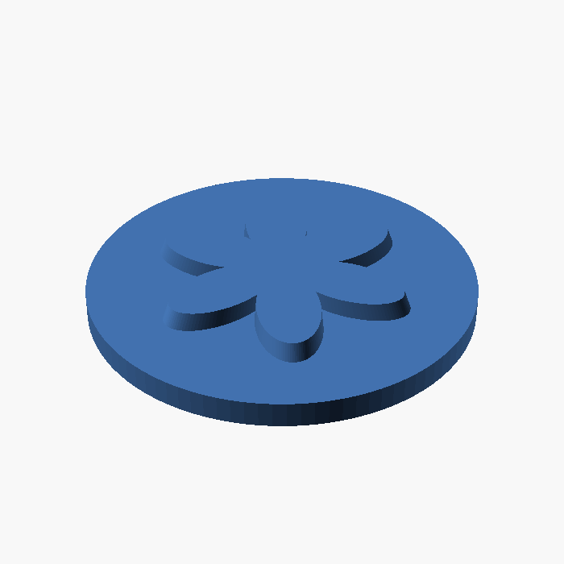
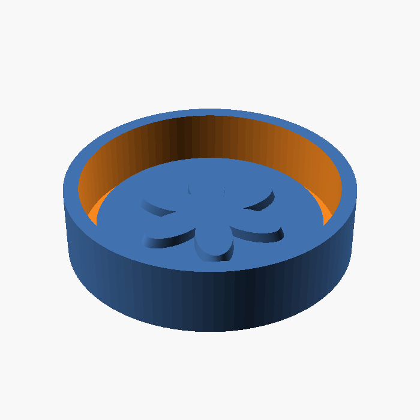
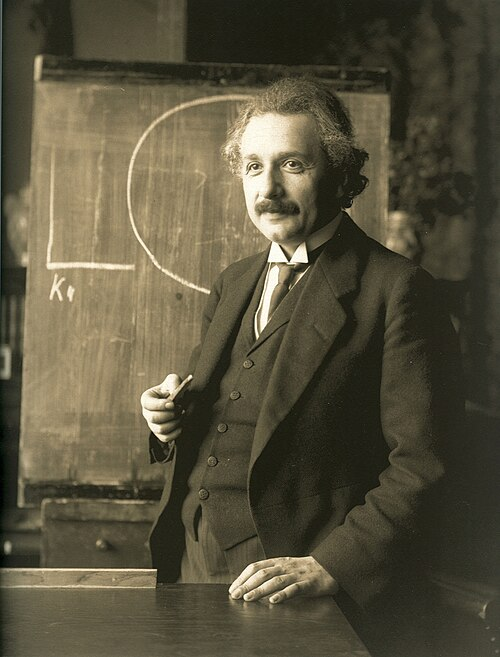
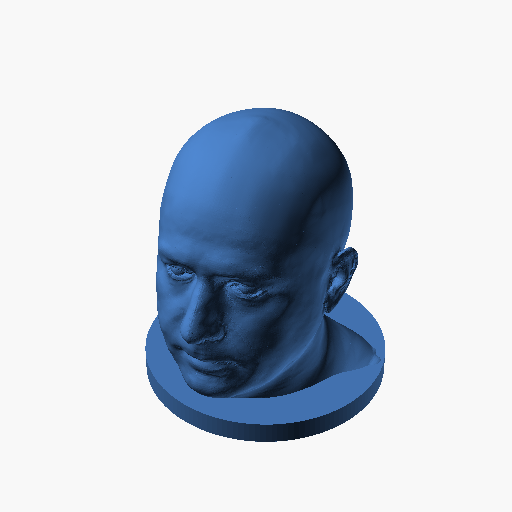
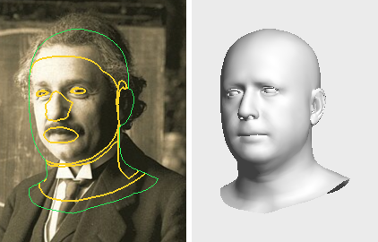
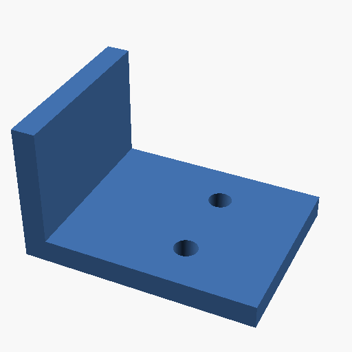
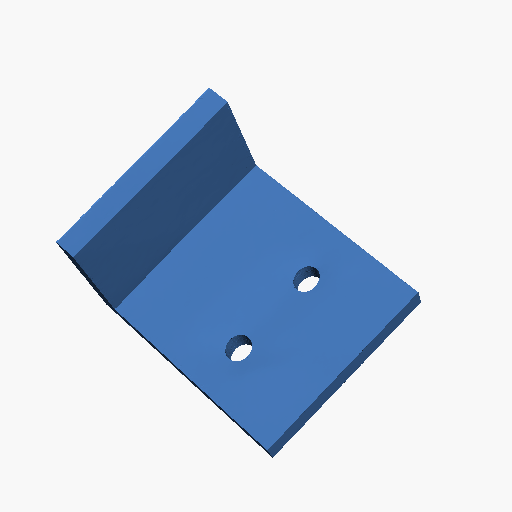

# Turn an image into a model, relief, or mold

Choose a route based on the object you want to make. A shallow relief, a full
object, and a portrait bust need different geometry and checks. Keep the source
image and your scale choices with the project so you can revise the result.

| Goal | Route | Files and checks |
| --- | --- | --- |
| Raised artwork, a plaque, a mold master, or a casting cavity | [Image-to-mold skill](../image-to-mold.md); optional Marigold V2 photo depth/normals | Calibrated 16-bit height map, positive/negative geometry, optional tray, mesh checks and sections |
| An object, figure, or character from one image | [Pixal3D or TRELLIS.2](../photo-object.md) | Scaled STL, generation settings and input hash; repair and validate before slicing |
| A recognizable head and printable bust from portraits | [FLAME reconstruction and print preparation](../flame-models.md#from-photographs-to-a-bust-in-one-step) | Fitted coefficients/detail maps, optional viewing texture, watertight bust STL and print-related reports |

The [optional photograph worker](../index.md#engines-and-integrations) needs its
model files and GPU setup. `status` and the available tool actions tell you
which routes are ready. Model downloads and licenses are separate from the
server's source license; follow each guide before obtaining or redistributing them.

## Artwork to a relief or mold

| Positive master | Tray with the master built into its floor |
| --- | --- |
|  |  |

The [example source](../../examples/workflows/flower-mold.scad) defines geometric
artwork and explicit heights: a 3 mm base and 2 mm raised flower. The master
is 46 mm across and 5 mm high. In the tray, its top is at Z = 7 mm, leaving
7 mm below the rim for the chosen silicone cover. The tray floor is 2 mm,
the outside diameter is 58 mm, and the inside diameter is 52 mm.


This section cuts through the raised flower. Build or preview the source with
`scad_build`, selecting `variant: "master"` or `variant: "tray"`; use `section`
at `z_mm: 4` on the master to reproduce the SVG. Supply the file's contents as
`source`, not its local filename. The [recorded run](../../evidence/documentation-workflows.md#relief-master-and-casting-tray)
passed solid-topology checks; casting, leak resistance, and physical release
have not been tested. This example assigns heights directly in source. For
arbitrary artwork or photograph relief, use the calibrated-map workflow below.

Load the instructions through `skill`:

```json
{"action":"get","params":{"name":"image-to-mold"}}
```

Provide the artwork, intended width/height in millimetres, raised/recessed
regions, and whether you want a positive master, a negative cavity, or a tray
for pouring silicone around a master. Clarify casting orientation and the
smallest details you want to reproduce.

For a photograph, `photo.depth` can supply relative depth and optional surface
normals. Its values are estimates, not millimetres. Calibrate the selected range
to chosen physical heights, compressing large steps if they would bury fine
detail. Flat artwork may be better served by deliberately assigned heights.

Build the geometry, inspect a section through the relief and cavity, and check
the actual exported solids. Compute tray clearance from the relief's real peak.
Then [slice and inspect toolpaths](model-to-printer.md) to see whether the nozzle
can reproduce the intended features. A height map cannot represent undercuts;
geometry checks do not establish silicone compatibility, leak resistance, or
successful release from a mold.

## Image to an object

Put a clear image of one subject in the workspace, then call `photo`:

```json
{"action":"object","params":{
  "image":"projects/figure/photos/input.png",
  "mesh_path":"projects/figure/models/figure.stl",
  "model":"pixal3d","size_mm":100,"resolution":1024,"background":true
}}
```

This is an example request for an existing project image. The STL's longest
side is set to `size_mm`; a single image cannot establish the original size.
Hidden sides are invented. Thin structures, lettering, or ambiguous views can
produce the wrong shape.

The background request returns a `job_id`; use `photo.status` for that exact
job, `photo.list` to find retained jobs, or `photo.cancel` to request cancellation.
TRELLIS.2 uses the same retained-job route with `model: "trellis2"` when configured.
Compare alternatives by their geometry, not a promise that one backend is best
for every subject.

Import the STL into Blender, inspect all sides, repair the surface if needed,
then export and validate it. The raw generated surface is not automatically a
checked solid. See [mesh-to-print steps](../photo-object.md#from-the-mesh-to-a-print)
and [generation jobs](../photo-object.md#retained-generation-jobs).

## Portraits to a bust

| Input photograph | Prepared bust geometry |
| --- | --- |
|  |  |

This [recorded example](../../evidence/documentation-workflows.md#portrait-reconstruction)
used the photograph by Ferdinand Schmutzer (1921),
[identified as public domain on Wikimedia Commons](https://commons.wikimedia.org/wiki/File:Einstein_1921_by_F_Schmutzer.jpg).
The model estimates the face; hair and the moustache were not reconstructed.
The bust passed solid-topology checks, while overhangs and thin-detail warnings
still called for print preparation. It has not been physically printed.



The fit diagnostic helps compare the estimated facial placement with the input.
Its overlap scores do not measure portrait likeness or recover unseen surfaces.

Use photographs you have permission to process and publish. Choose sharp,
unobstructed views of the same person; identify which view should set expression
and detail. With the required models ready, `head.photo_to_bust` combines
reconstruction and preparation:

```json
{"action":"photo_to_bust","params":{
  "reconstruct":{
    "images":["projects/portrait/photos/front.jpg"],
    "displacement_path":"projects/portrait/detail.png"
  },
  "print":{"path":"projects/portrait/bust.stl","printer":{"process":"fdm"}},
  "detail":{"relief_mm":0.3}
}}
```

The paths name your existing image and new outputs. Read the
[bust guide](../flame-models.md#prepare-a-bust-for-printing) to choose size,
base, expression, eyes, mouth, hair, and detail suitable for the intended process.
Inspect the fit picture when requested and compare more than the front view.
An estimated face or hair cap is not a physical scan or a guarantee of likeness.

Use `head.create` for a Blender head with supported appearance options, and
`head.export` for OBJ. A viewing color map does not add color to the printed STL.
Keep reconstruction results so you can adjust preparation without repeating
the fit. Review the generated bust and its overhang/thin-detail evidence before
[slicing](model-to-printer.md).

## An image is not a dimensioned CAD model

| Source CAD view | Image-generated shape |
| --- | --- |
|  |  |

Pixal3D generated the second shape from the first image at resolution 512 with
a chosen longest side of 40 mm. It reported bounds of approximately
40 × 32.7 × 36.7 mm; the original CAD bracket is 40 × 30 × 24 mm.
The input is a render, not a photograph. This example shows why an inferred
shape needs inspection and why [source-based CAD](functional-parts.md) is the
appropriate route when a mounting pattern or exact dimension must be preserved.
The raw generated mesh has not been repaired or qualified for printing.
