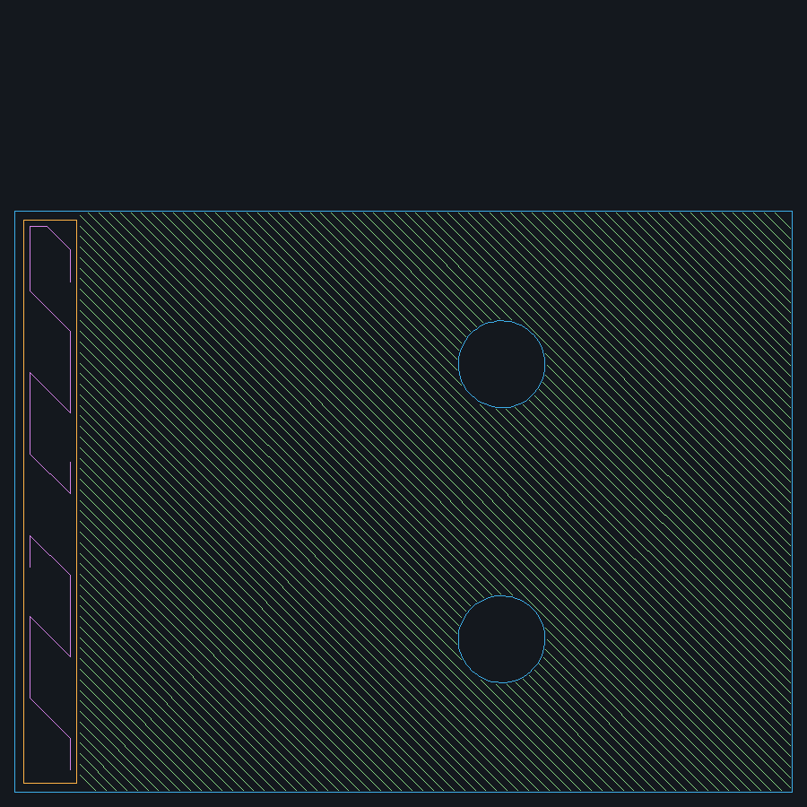

# Slice, review, and send a print

Printable can take a project model through native OrcaSlicer preparation,
review the generated toolpaths, send the package to Bambuddy, and start the
print. You can also stop after slicing and download the files for another
delivery method. Printer observation and control are part of this workflow;
they are not the whole printing capability.



This is an XY preview of generated G-code, not a model render. It shows layer
20 at Z = 4 mm from the [bracket example](functional-parts.md), sliced for an
X1 Carbon with a 0.4 mm nozzle, PLA Basic, 0.20 mm layers, and Textured PEI.
It establishes what was previewed; no physical print was started in this
[documentation run](../../evidence/documentation-workflows.md).

## Choose the setup

Start with a project-relative STL or 3MF. Convert STEP through
[native CAD](../cad-build.md) first. Preserve a 3MF's plate arrangement and
material indices unless you deliberately change them.

Load the `prepare-fdm-print` instructions through `skill`:

```json
{"action":"get","params":{"name":"prepare-fdm-print"}}
```

The [preparation guide](../fdm-preparation.md) helps choose orientation, profiles,
walls, supports, fit, and surface-finish settings for the intended use. Loading
instructions does not slice or print. Check source dimensions and units and
identify critical faces or loads before making those choices.

Discover profiles with `slice.profiles`, then inspect relevant inherited
values and allowed setting names with `slice.settings`. Match the actual
printer model and nozzle, filament product/variant, and installed build surface.
The packaged BBL profile collection includes vendor filaments; a profile's
presence does not prove compatibility with every printer.

For the example setup, pass this to `slice`:

```json
{"action":"profiles","params":{"category":"printer","query":"X1 Carbon 0.4","limit":5}}
```

Repeat discovery for `process` and `filament` with the selected `printer` name.
Use returned names, not an inferred abbreviation. Multi-material selections are
ordered by source filament index. Colors belong to those slots; AMS tray mapping
is a later printer choice.

## Prepare the package

The [checked-in request](../../examples/workflows/slice.json) slices the completed
40 mm bracket. It is a software example for the setup above; change the selected
profiles and surface for your actual machine before using it physically.

```sh
python3 scripts/printable_client.py call slice examples/workflows/slice.json
```

Retain the returned handle. Use `slice` with the following request until its
status is terminal, with waiting owned by your client rather than repeated
assistant messages:

```json
{"action":"status","params":{"project_id":"bracket-tutorial","output_dir":"slice-40"}}
```

Inspect native warnings and failures. A completed result names G-code and a
`.gcode.3mf` package, resolved setup, hashes, and provenance. If the connection
is lost, inspect that same handle before submitting another preparation. Use
`cancel` on the handle when you want to stop active work.

## Review actual toolpaths

Use a G-code filename returned in `artifacts`; the example produced
`plate_1.gcode`. Pass this to `slice` to reproduce the picture above:

```json
{"action":"review","params":{
  "slice":{"project_id":"bracket-tutorial","output_dir":"slice-40"},
  "toolpath":"plate_1.gcode","first_layer":20,"last_layer":20,"size":900
}}
```

Inspect the first layer, fitting features, supported regions, and other relevant
heights as well. A single selected layer is not a review of the whole print.
Look for missing thin features, unexpected gaps, support contact, and material
assignment. The preview records its exact G-code identity and selected layers.
It does not establish adhesion or strength.

You can download the completed package without a printer integration:

```sh
python3 scripts/printable_client.py download projects/bracket-tutorial/slice-40/model.gcode.3mf .dev/bracket.gcode.3mf
```

## Send, stage, and start through Bambuddy

Configure the [optional printer integration](../printer-integration.md) and read
the [printing instructions](../../crates/printable-server/resources/printing-workflow-v1.md)
before physical work. Obtain authorization to print and confirm the target,
installed plate and upward-facing surface, bed clearance, nozzle, and filament.
Reuse current explicit answers. A camera view or idle status cannot establish
all those physical facts.

1. **Send the reviewed package.** Call `print.import` with `project_id` and the
   project-relative `path`, here `slice-40/model.gcode.3mf`. When available,
   include `evidence.slice` from completed preparation and
   `evidence.toolpath_review` from review, each as the returned path/SHA-256
   reference. Printable checks their relationship to the exact upload.
2. **Review the target.** Read `printer.list`, selected status and materials.
   Call `print.review` with `source: {"kind":"library","id":…}` using the
   library file identity returned by import, the chosen `printer_id`, plate,
   and proposed material mapping. Resolve unknowns and mismatches. Review
   observes state; it does not reserve a printer.
3. **Stage for manual start.** Call `print.stage` with that `library_file_id`,
   target `printer_id`, `plate`, ordered `ams_mapping`, and `use_ams`. Choose
   calibration and timelapse options for the hardware. Use reported tray IDs;
   do not infer them from display labels. Read the effective setup and returned
   print identity.
4. **Start the staged job.** Recheck current printer context and physical
   readiness, then explicitly call `print.start` with the returned `print_id`.
   Keep filament checks enabled. Bambuddy owns authoritative scheduling and
   dispatch checks.
5. **Observe what happened.** Read `print.status` for the job and selected
   `printer.status` sections. A start acknowledgement means the request was
   accepted; later observations establish whether execution or completion was
   reported. Inspect the physical part for its intended fit and use.

Use the selected action contracts for exact parameters:
`printable://contracts/print/import`, `printable://contracts/print/review`,
`printable://contracts/print/stage`, and `printable://contracts/print/start`.
The ellipsis above represents an actual returned identity, not a value to copy.
Keep those identities and [delivery evidence](../delivery-evidence.md) with the
project. Printable's local upload digest does not independently verify the
bytes ultimately executed by Bambuddy.

## Monitor and recover

`printer.snapshot` saves a camera frame to the project. The
[camera inspection skill](../printer-camera-inspection.md) guides a client's
vision model in reporting visible failures and blind spots. A schedule,
notifications, or automatic intervention needs the corresponding client runtime
and authorization. Loading a skill alone starts no monitor.

For Bambuddy's ongoing ML failure detection, configure
[Obico](../print-failure-detection.md). It is separate from the client's visual
assessment. Neither establishes unseen geometry or physical readiness.

If import, stage, start, or control returns an unknown outcome, inspect the
backend and retained job records before acting again. Never automatically
replay an uncertain mutation. `clear_plate` acknowledges actual part removal
and can release queued printing; it is not a way to dismiss a software warning.
See [printer failure semantics](../printer-integration.md#failure-semantics).
