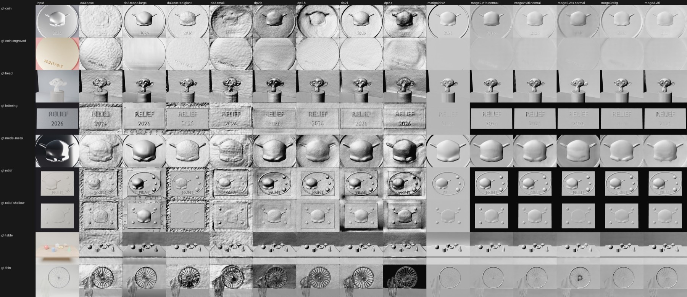

# Depth benchmark, 25 November 2026

Measured with [the depth benchmark](../scripts/depth_benchmark/README.md) to
choose the photograph worker's depth, normal, mask and focal-length models.
Quality decides the default; memory and time decide only the fallbacks.
Full numbers are in [depth-benchmark.json](depth-benchmark.json).

## Environment

- One NVIDIA RTX 4090 (24 GB) and a 32-thread CPU, Linux.
- Container `pytorch/pytorch:2.14.1-cuda13.0-cudnn9-devel`, the photograph
  worker's PyTorch and CUDA versions; Blender 5.3.0 for the scenes.
- Marigold V2 ran through `recon/printable_recon/marigold.py` after
  conversion with `recon/convert_marigold.py`, reading from a local SSD.
- Model code at the revisions pinned in the benchmark's Dockerfile; Python
  packages as listed in [depth-benchmark-packages.txt](depth-benchmark-packages.txt);
  weights from each project's published checkpoints.
- Inputs at 1024 pixels on the longest side: nine rendered scenes with exact
  depth and normals, and fifteen photographs. Tiers: `gpu` (no limit),
  `budget` (3 GB allocator limit) and `cpu` (no GPU visible; five inputs per
  model, two for Marigold V2).

Each row is a scene; each column shows a model's surface lit from the upper
left (its own normals where it has them, otherwise normals from its depth).

## Quality on the rendered scenes (GPU)

Means over nine scenes; 95 % bootstrap intervals in brackets. Lower is better
except edge F1.

| Model | Model normals, deg | Normals from depth, deg | Relief height error, % | Depth error, % | Edge F1 |
| --- | --- | --- | --- | --- | --- |
| Marigold V2 | **4.1** (2.6-5.8) | 8.1 (5.3-10.8) | 15.7 (11.4-20.0) | 0.83 | 0.99 |
| MoGe-3 ViT-L | 5.4 (3.0-8.2) | 11.7 (7.0-17.5) | 15.1 (10.7-20.6) | 0.99 | 0.97 |
| MoGe-3 ViT-g | 6.0 (3.2-9.3) | 9.4 (5.3-14.5) | 15.2 (9.8-21.1) | 0.92 | 0.98 |
| MoGe-2 ViT-L normal | 6.0 (3.5-9.1) | 14.5 (7.8-23.5) | **12.7** (9.3-16.9) | 1.04 | 0.92 |
| MoGe-2 ViT-B normal | 7.6 (3.9-12.4) | 13.6 (8.3-20.6) | 16.5 (10.5-24.6) | 1.29 | 0.94 |
| MoGe-2 ViT-S normal | 9.6 (5.2-15.2) | 18.0 (11.2-26.0) | 29.1 (17.3-43.2) | 1.48 | 0.88 |
| Depth Anything 3 mono large | none | **3.8** (2.9-4.9) | 15.0 (11.0-18.7) | **0.75** | 0.93 |
| Depth Anything 3 nested giant | none | 9.2 (6.2-12.7) | 14.3 (9.8-18.4) | 1.01 | 0.86 |
| Depth Anything 3 base | none | 9.6 (6.5-12.6) | 23.4 (16.8-31.7) | 1.48 | 0.76 |
| Depth Anything 3 small | none | 13.0 (8.8-17.4) | 23.8 (20.2-27.6) | 2.07 | 0.68 |
| Depth Pro 2 H+ | none | 14.5 (9.8-19.4) | 23.5 (12.3-38.9) | 1.11 | **0.99** |
| Depth Pro 2 L | none | 14.4 (9.6-19.7) | 14.9 (11.1-18.4) | 1.03 | 0.99 |
| Depth Pro 2 B | none | 18.9 (13.7-25.0) | 17.9 (13.0-22.3) | 1.66 | 0.98 |
| Depth Pro 2 S | none | 28.7 (21.2-36.7) | 20.3 (15.0-25.0) | 2.40 | 0.97 |

Relief height error is measured in each relief region after the scale and
offset a user would choose and removal of a best-fit plane, as a percentage of
the region's relief depth. Depth error is after scale and offset alignment.

## Combining depth and normals

Averaged over the seven scenes with a relief region (GPU). Fusion takes broad
shape from the depth map and detail from the integrated model normals, without
integrating across depth jumps; sigma is the blur separating the two.

| Depth | Normals | Surface error, deg | Height error, mm |
| --- | --- | --- | --- |
| Marigold V2 | none (depth only) | 8.8 | 6.7 |
| Marigold V2 | Marigold V2, sigma 4 | **5.9** | **6.2** |
| Marigold V2 | Marigold V2, normals only | 5.7 | 6.8 |
| MoGe-3 ViT-L | Marigold V2, normals only | 6.0 | 8.1 |
| MoGe-3 ViT-g | MoGe-3 ViT-g, normals only | 8.4 | 7.2 |
| Depth Anything 3 nested giant | none (depth only) | 11.0 | 9.1 |

Marigold V2's own depth fused with its own normals gave the best combination
of surface direction and height.

## Focal length

Mean absolute error against EXIF on the four photographs that record a 35 mm
equivalent focal length: Depth Pro 2 8.3 % (every size, which share one
field-of-view estimator), MoGe-2 ViT-L 20.4 %, MoGe-3 ViT-L 22.6 %, MoGe-3
ViT-g 32.3 %, Depth Anything 3 nested giant 37.6 %. On the scenes, every
metric model misjudged the distance of close-up subjects by several times.

## Cost

Median per image at 1024 pixels, excluding model loading and one warm-up
image; peak GPU memory is allocator memory.

| Model | GPU time | GPU memory | Fits 3 GB | CPU time | CPU memory |
| --- | --- | --- | --- | --- | --- |
| Marigold V2 (depth and normals) | 6.1 s | 2.0 GB | yes | 390 s (max 486 s) | 4.0 GB |
| MoGe-3 ViT-L | 0.26 s | 2.7 GB | yes | does not run | |
| MoGe-3 ViT-g | 0.57 s | 6.7 GB | no | does not run | |
| MoGe-2 ViT-L normal | 0.06 s | 2.3 GB | yes | 6.9 s | 3.3 GB |
| Depth Pro 2 L | 0.05 s | 3.1 GB on the full GPU; 2.4 GB under the cap | yes | 8.3 s | 4.2 GB |
| Depth Pro 2 H+ | 0.09 s | 5.2 GB | no | 13.7 s | 7.4 GB |
| Depth Anything 3 mono large | 0.07 s | 2.4 GB | yes | 13.0 s | 3.8 GB |
| Depth Anything 3 nested giant | 0.25 s | 8.7 GB | no | 55 s | 13.4 GB |

At 2048 pixels Marigold V2 took 12.3 s with 2.5 GB. MoGe-3 depends on Triton
and does not load without an NVIDIA GPU. Storage reads were zero in these runs
because model files were already in the page cache; a cold Marigold V2 read
is about 13 GB per map, as [the depth guide](../docs/photo-depth.md) states.

## Chosen routes

| Role | Default (GPU within 3 GB) | CPU fallback | Artwork ("sculpture") |
| --- | --- | --- | --- |
| Normals (detail) | Marigold V2 | Marigold V2 | Marigold V2 |
| Depth (broad shape) | Marigold V2, fused with its normals | Marigold V2, fused with its normals | Depth Anything 3 mono large or Depth Pro 2 L |
| Subject mask | MoGe-3 ViT-L | MoGe-2 ViT-L normal | MoGe-3 ViT-L |
| Focal length | Depth Pro 2 field-of-view estimator | the same | the same |

Run one model at a time, the default route peaks at about 2.7 GB of GPU
memory and its inference takes under 10 s per image, plus model loading; the
CPU route's inference takes under 9 minutes on this CPU. The highest-quality route fits the default 3 GB budget, so no quality
is traded for memory.

## Limits

- Nine computer-generated scenes; intervals overlap for several close pairs,
  notably relief height error, which does not separate the leading models.
- The engraved coin (1 mm engraving) was poorly recovered by every model.
- Photographs were judged visually except for focal length.
- CPU results use five inputs per model (two for Marigold V2).
- One run per image; DSINE was not measured because its weights are published
  only through a file-sharing link, without a verifiable checksum.
- The MoGe-2 CPU runs were repeated after fixing the runner's precision
  setting; the report lists the first attempt's failure alongside the results.
